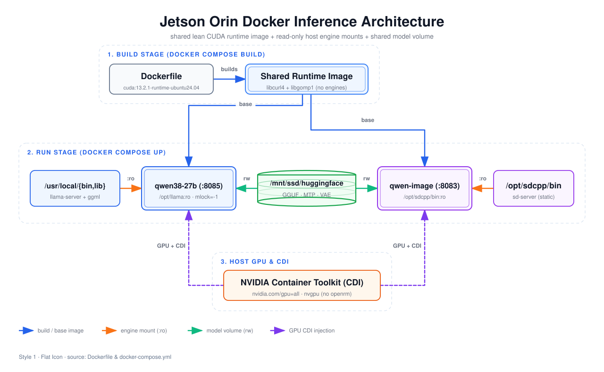

# Jetson Orin 本地推理服务

本项目使用 Docker Compose 在 NVIDIA Jetson Orin AGX（JetPack 7.2 / CUDA 13.2.1 / Ubuntu 24.04）上运行本地 GGUF 推理服务：

- `qwen38-27b`：LLM 文本推理服务（基于 `llama.cpp`）
- `qwen-image`：文生图与图片编辑服务（基于 `stable-diffusion.cpp`）

> 仓库早期曾包含 Gemma-4 等模型配置，现已精简为仅维护上述两个服务。

**目录**

- [0. 架构总览](#0-架构总览)
- [1. 快速开始](#1-快速开始)
- [2. 服务、端口与日常管理](#2-服务端口与日常管理)
- [3. 模型更新](#3-模型更新)
- [4. 更新推理引擎](#4-更新推理引擎)
- [5. Docker 构建策略与兼容性修复](#5-docker-构建策略与兼容性修复)
- [6. 性能优化与故障排查](#6-性能优化与故障排查)
- [7. Pi Agent / Prime Agent 接入](#7-pi-agent--prime-agent-接入)
- [8. 参考资源](#8-参考资源)

## 0. 架构总览

核心设计为**轻量运行时镜像 + 宿主机预编译引擎只读挂载 + 宿主机共享模型卷**：`docker compose build` 仅打包 CUDA runtime 与少量系统库（两个服务共用同一份 [Dockerfile](Dockerfile)），不编译推理引擎也不打包模型；`docker compose up` 创建容器时再按 [docker-compose.yml](docker-compose.yml) 挂载宿主机二进制、模型目录和 GPU。



> 克隆到本地后可用浏览器打开 [docker-architecture.html](docs/architecture/docker-architecture.html) 查看交互式架构图；原始结构化描述见 [docker-architecture.json](docs/architecture/docker-architecture.json)。

| 内容 | 是否进入 Image | Host 来源 | Container 内路径 / 生效方式 | 更新方式 |
| --- | --- | --- | --- | --- |
| CUDA 运行库和系统依赖 | 是 | NGC `cuda:13.2.1-runtime-ubuntu24.04`、`Dockerfile` | 镜像内系统库（含 `libcurl4`、`libgomp1`） | 修改 `Dockerfile` 后 `docker compose build` |
| `llama-server` 与共享库 | 否 | `/usr/local/bin`、`/usr/local/lib` | `qwen38-27b`：`/opt/llama/bin`、`/opt/llama/lib`（`:ro`，避开 CDI 扫描） | 宿主机编译安装后启动或重启 `qwen38-27b` |
| `sd-server`（静态链接 `ggml`） | 否 | `/opt/sdcpp/bin` | `qwen-image`：`/opt/sdcpp/bin`（`:ro`，与 `llama.cpp` 隔离） | 宿主机编译安装后启动或重启 `qwen-image` |
| 模型权重与附属文件 | 否 | `/mnt/ssd/huggingface` | 两服务共用：`/root/.cache/huggingface`（读写） | 使用更新脚本后启动或重启对应服务 |
| GPU 与 NVIDIA Driver | 否 | Jetson 宿主机 | `runtime: nvidia` + `nvidia.com/gpu=all` + `NVIDIA_VISIBLE_DEVICES=all` / `NVIDIA_DRIVER_CAPABILITIES=all` | 更新 JetPack/驱动和宿主机配置 |
| 运行时参数与网络 | 否 | `docker-compose.yml` | `network_mode: host`、`GGML_CUDA_ENABLE_UNIFIED_MEMORY=1`、`ulimits.memlock: -1` | `docker compose up -d <service>` 重建容器 |

## 1. 快速开始

### 1.1 系统要求

- NVIDIA Jetson Orin AGX，已安装 JetPack 7.2 和 NVIDIA Container Toolkit
  - **首次在 JetPack 7.2 上部署前，请先完成 [5.2 NVIDIA Container Toolkit 兼容性修复](#52-nvidia-container-toolkit-兼容性修复)**，否则启动容器可能触发 `slice bounds out of range` panic。
- Docker 与 Docker Compose v2
- SSD 挂载到 `/mnt/ssd/`，并提前创建模型目录 `/mnt/ssd/huggingface/`（若使用其他目录，需同步修改 `docker-compose.yml` 中的卷挂载路径）
- 宿主机已编译并安装 `llama.cpp` 到 `/usr/local`（尚未准备见 [4.1 节](#41-更新-llamacppusrlocal)）
- （可选，使用 `qwen-image` 时需要）宿主机已编译并安装 `stable-diffusion.cpp` 到 `/opt/sdcpp`（见 [4.2 节](#42-更新-stable-diffusioncppoptsdcpp)）

### 1.2 构建运行时镜像

```bash
# 构建全部服务的运行时镜像（只创建镜像，不会启动容器）
docker compose build

# 也可以只构建单个服务
docker compose build qwen38-27b
```

> 首次直接执行 `docker compose up -d <service>` 时，若本地尚无对应镜像，Compose 也会自动触发构建。

### 1.3 下载模型并启动服务

优先使用仓库脚本 [`scripts/update-models.py`](scripts/update-models.py) 从 ModelScope 下载模型：

```bash
# 查看可用的 Compose 服务名
python3 scripts/update-models.py --list

# 下载一个模型（默认写入 /mnt/ssd/huggingface）
python3 scripts/update-models.py qwen38-27b

# 启动单个模型服务
docker compose up -d qwen38-27b
```

若系统未安装 `modelscope`，脚本会自动通过 `uv run --no-project --with modelscope` 临时运行，不污染系统环境；运行前会自动清除代理环境变量，直连中国大陆 ModelScope。

### 1.4 验证服务

在局域网内另一台设备上验证 `qwen38-27b`（本机测试可将 `<JETSON_IP>` 改为 `localhost`）：

```bash
curl -sN http://<JETSON_IP>:8085/v1/chat/completions \
  -H 'Content-Type: application/json' \
  -d '{
    "model": "qwen3.8-27b",
    "messages": [{"role": "user", "content": "你好"}],
    "chat_template_kwargs": {"enable_thinking": true},
    "stream": true
  }'
```

`qwen-image` 的启动与请求验证见 [2.3 节](#23-qwen-image-图像服务用法)。

## 2. 服务、端口与日常管理

所有服务使用 `network_mode: host`，无 Docker 端口映射。

| Compose 服务 | 模型 | 后端端口 | 上下文 | 适用场景 |
| --- | --- | ---: | ---: | --- |
| `qwen38-27b` | Qwen3.8 27B Dense（MTP 推测解码） | 8085 | 256K | 通用推理、编程、长上下文 |
| `qwen-image` | Qwen-Image-2.1 (sd.cpp) | 8083 | — | 文生图、图片编辑（支持参考图） |

> **64GB 统一内存共存提示**：`qwen38-27b` 仅模型权重约 18.3 GB（叠加 256K KV 缓存与 `--cache-ram 8192` 后，长上下文场景可接近或超过 64GB 物理内存）；`qwen-image` 权重约 10.4 GiB（常驻约 10.2 GiB）。两者同时运行前请先通过 `jtop` / `docker stats` 确认可用内存余量，必要时先配置 [6.1 16GB Swap](#61-扩大-swap)，或使用 `docker compose stop` 暂时停掉不需要的服务。

### 2.1 服务管理命令

```bash
# 验证 docker-compose.yml（YAML 语法、锚点与变量插值）
docker compose config --quiet

# 查看运行状态与实时日志
docker compose ps
docker compose logs -f
docker compose logs -f --tail=100 -t qwen38-27b

# 启动单个服务（也会自动检测并应用 docker-compose.yml 变更）
docker compose up -d qwen38-27b

# 强制重建单个服务（修改镜像、环境变量、卷、设备或 ulimits 后推荐使用）
docker compose up -d --force-recreate qwen38-27b

# 重启已存在容器（不重新解析环境变量、卷或 ulimits 等变更）
docker compose restart qwen38-27b

# 停止服务（保留容器）/ 停止并删除容器（不删除镜像与模型文件）
docker compose stop
docker compose down
```

### 2.2 资源监控

```bash
jtop          # Jetson 整机 GPU/CPU/内存/功耗状态
docker stats  # 各容器 CPU、内存与 I/O 占用
```

### 2.3 qwen-image 图像服务用法

`qwen-image` 由 `sd-server` 提供服务，同时暴露 OpenAI 兼容（`/v1/images/*`）、A1111 WebUI 兼容（`/sdapi/v1/*`）和原生异步任务（`/sdcpp/v1/*`）三套 API，返回图片均为 base64。

**文生图**（OpenAI 兼容端点）：

```bash
curl -s http://localhost:8083/v1/images/generations \
  -H 'Content-Type: application/json' \
  -d '{
    "prompt": "a cartoon sloth mascot waving, flat vector illustration",
    "size": "1024x1024",
    "output_format": "png"
  }' | python3 -c 'import json,base64,sys; d=json.load(sys.stdin)["data"][0]["b64_json"]; open("out.png","wb").write(base64.b64decode(d))'
```

**图片编辑**（请使用原生异步 API `/sdcpp/v1/img_gen` + `ref_images`）：

```bash
python3 - <<'EOF'
import base64, json, time, urllib.request

b64 = base64.b64encode(open("<输入图.png>", "rb").read()).decode()
body = {
    "prompt": "change 'IF' to 'ID'",          # 编辑指令
    "ref_images": ["data:image/png;base64," + b64],
    # "width"/"height" 可省略，默认沿用参考图尺寸
}
opener = urllib.request.build_opener(urllib.request.ProxyHandler({}))
req = urllib.request.Request("http://localhost:8083/sdcpp/v1/img_gen",
    data=json.dumps(body).encode(), headers={"Content-Type": "application/json"})
job = json.load(opener.open(req, timeout=30))              # 提交任务
while True:                                                # 轮询直到完成
    time.sleep(5)
    st = json.load(opener.open(urllib.request.Request(
        f"http://localhost:8083/sdcpp/v1/jobs/{job['id']}"), timeout=30))
    if st["status"] == "completed":
        open("out.png", "wb").write(base64.b64decode(st["result"]["images"][0]["b64_json"]))
        print("saved out.png"); break
    if st["status"] in ("failed", "cancelled"):
        raise SystemExit(st)
EOF
```

注意事项：

- **编辑勿用 `/v1/images/edits`**：OpenAI 兼容编辑端点会把第一张上传图同时当作 init 图（img2img 语义），实测会导致编辑指令不生效；文生图端点 `/v1/images/generations` 不受影响。
- 编辑指令措辞参考官方示例风格（如 `change 'A' to 'B'`），可将保持其余部分不变的约束一并写入 `prompt`。
- 宿主机命令行批量编辑可直接调用 `sd-cli`（与容器一致默认使用 `--sage-attn`）：

  ```bash
  /opt/sdcpp/bin/sd-cli \
      --diffusion-model /mnt/ssd/huggingface/qwen-image-2.1-Q4_K_M.gguf \
      --vae /mnt/ssd/huggingface/vae/qwen_image_2.1_vae_bf16.safetensors \
      --llm /mnt/ssd/huggingface/Qwen3-VL-8B-Instruct-UD-Q4_K_XL.gguf \
      --llm_vision /mnt/ssd/huggingface/mmproj-BF16.gguf \
      --cfg-scale 6.0 --sage-attn \
      -r <输入图.png> -p "change 'A' to 'B'" -o <输出图.png>
  ```

- 生成尺寸必须能被 32 整除；采样参数通过 `sd_cpp_extra_args` 传递（OpenAI/A1111 端点内嵌在 `prompt` 中，如 `<sd_cpp_extra_args>{"sample_params":{"sample_steps":28}}</sd_cpp_extra_args>`，原生 `/sdcpp/v1/*` 直接写在请求体），完整字段见 `sd.cpp` 仓库 `examples/server/api.md`。
- 需要 RGBA 透明输出时，在 `prompt` 中加入固定句式：`This is an RGBA image with transparency. <描述>. The image has alpha channel and the background is transparent.`（仅 `png`/`webp` 保留透明通道）。
- AGX 实测耗时（Q4_K_M，832×832）：文生图 12 步约 2.5 分钟；编辑默认步数约 4 分钟。

## 3. 模型更新

[`scripts/update-models.py`](scripts/update-models.py) 统一维护各服务的 ModelScope 仓库与本地文件映射；其中 `qwen-image` 的四件套（扩散模型、VAE、文本编码器、mmproj）分属三个仓库，由脚本的 `extra_downloads` 统一拉取。

```bash
# 演练检查将执行的下载命令（不发起下载请求）
python3 scripts/update-models.py --dry-run qwen38-27b

# 更新指定模型或全部模型
python3 scripts/update-models.py qwen38-27b qwen-image
python3 scripts/update-models.py --all

# 指定其他目录（需同步修改 docker-compose.yml 中的模型路径）
python3 scripts/update-models.py --model-dir /mnt/ssd/huggingface-test qwen38-27b
```

下载完成后生效：若服务正在运行，执行 `docker compose restart <service>`；若未运行，执行 `docker compose up -d <service>`。

如需手动下载，推荐用 `uv` 隔离安装 `modelscope`：

```bash
uv tool install --python 3.12 modelscope
modelscope download unsloth/Qwen3.8-27B-GGUF \
    Qwen3.8-27B-UD-Q4_K_XL.gguf \
    --local-dir /mnt/ssd/huggingface --max-workers 1
```

## 4. 更新推理引擎

两个引擎通过 git submodule 管理，在宿主机编译安装后直接通过只读挂载生效，**不需要重新构建 Docker 镜像**：

- `llama.cpp` → 安装到 `/usr/local`（供 `qwen38-27b`）
- `stable-diffusion.cpp` → 安装到独立前缀 `/opt/sdcpp`（供 `qwen-image`）

### 4.1 更新 llama.cpp（/usr/local）

```bash
sudo apt install ninja-build
git submodule update --init --remote --checkout llama.cpp

cmake -S llama.cpp -B llama.cpp/build -G Ninja \
    -DCMAKE_BUILD_TYPE=Release \
    -DGGML_NATIVE=ON \
    -DGGML_CUDA=ON \
    -DCMAKE_CUDA_ARCHITECTURES=87 \
    -DGGML_CUDA_FA=ON \
    -DGGML_CUDA_FA_QUANTS=all \
    -DGGML_CUDA_GRAPHS=ON \
    -DGGML_CUDA_NO_VMM=ON \
    -DGGML_CUDA_CCCL_VERSION=v3.4.3

cmake --build llama.cpp/build --config Release --parallel
sudo cmake --install llama.cpp/build --prefix /usr/local
# 若 /usr/local/lib 尚不在动态链接器路径中，先执行：
# echo "/usr/local/lib" | sudo tee /etc/ld.so.conf.d/usr_local_lib.conf
sudo ldconfig
```

关键 CMake 选项说明（Jetson Orin AGX / JetPack 7.2）：

- `CMAKE_CUDA_ARCHITECTURES=87`：Orin 的 compute capability `sm_87`。
- `GGML_CUDA_NO_VMM=ON`：Jetson 为 UMA 统一内存架构，Tegra 不支持 CUDA VMM（`cuMemCreate`），必须关闭。
- `GGML_CUDA_FA_QUANTS=all`：为 FlashAttention 内核（`fattn-vec`、`fattn-tile`、`fattn-mma-f16`）编译全部 64 种 K/V 量化组合；上游默认仅编译 5 种对称组合，不包含 `qwen38-27b` 使用的 `--cache-type-k q8_0 --cache-type-v q4_0`（也可按需只编含 `q8_0-q4_0` 的列表缩短编译时间）。替代已弃用的 `GGML_CUDA_FA_ALL_QUANTS`。
- `GGML_CUDA_CCCL_VERSION=v3.4.3`：JetPack 7.2 自带 CCCL 3.0.2，显式拉取 3.4.3 可启用 CUB `DeviceTopK` 快速路径（configure 阶段需直连 `github.com`；网络受限时可省略，仅影响 top-k 采样速度）。

安装完成后，服务未启动时执行 `docker compose up -d qwen38-27b`，运行中执行 `docker compose restart qwen38-27b`。

> `.gitmodules` 已配置 `llama.cpp` 与 `stable-diffusion.cpp` 跟踪 `master` 并忽略指针变更，更新子模块后主仓库不会提示脏状态。

### 4.2 更新 stable-diffusion.cpp（/opt/sdcpp）

**必须安装到独立前缀 `/opt/sdcpp`**：`sd.cpp` 自带 fork 版 `ggml`，与 `llama.cpp` 在 `/usr/local/lib` 中的 `ggml` 共享库同名但不兼容，混装会互相覆盖。默认静态链接 `ggml` 等内部库（`SD_BUILD_SHARED_LIBS=OFF`），仍动态链接镜像内的 CUDA runtime / `libgomp1` 与宿主机 NVIDIA 驱动库；安装产物仅 `bin/sd-cli`、`bin/sd-server`。

```bash
git submodule update --init --remote --checkout stable-diffusion.cpp

# sd.cpp 还包含 ggml fork、libwebp 等嵌套子模块；直连 GitHub 慢时保留 --depth 1
git -C stable-diffusion.cpp submodule update --init --recursive --depth 1

cmake -S stable-diffusion.cpp -B stable-diffusion.cpp/build -G Ninja \
    -DCMAKE_BUILD_TYPE=Release \
    -DSD_CUDA=ON \
    -DCMAKE_CUDA_ARCHITECTURES=87 \
    -DGGML_CUDA_NO_VMM=ON

cmake --build stable-diffusion.cpp/build --parallel
sudo cmake --install stable-diffusion.cpp/build --prefix /opt/sdcpp
```

安装完成后，服务未启动时执行 `docker compose up -d qwen-image`，运行中执行 `docker compose restart qwen-image`。

补充说明：

- **Jetson/UMA 优化现状**：`sd.cpp` 无额外 Jetson 专用编译开关。容器通过环境变量 `GGML_CUDA_ENABLE_UNIFIED_MEMORY=1` 触发 `cudaMallocManaged` 与系统内存预算计算（当前 `ggml` CUDA 代码将 `integrated` 硬编码为 `false`，因此依赖该变量显式启用 UMA）；`sm_87` 对应的 MMVQ 分支由 `-DCMAKE_CUDA_ARCHITECTURES=87` 编译并在运行时选择；`GGML_CUDA_GRAPHS` 在 `ggml` 中为 `llama.cpp` 专用，不适用于 `sd.cpp`。
- **SageAttention（`--sage-attn`，已启用）**：补丁版 `ggml` 自带原生 CUDA INT8 注意力 kernel（`sm_87` 走 SM80+ 兼容路径，无需额外开关），AGX 实测采样比 `--diffusion-fa` 快约 10%（832×832、20 步、同种子：169.8s → 151.8s）；注意力量化会轻微改变同种子数值输出，不支持的层自动回退 FlashAttention。详见 `sd.cpp` 仓库 `docs/sage_attention.md`。
- **已知上游 UMA Issue**：[#1586](https://github.com/leejet/stable-diffusion.cpp/issues/1586)（运行时切换模型在 UMA 上可能 SEGV；本部署固定单一模型不受影响）、[#1587](https://github.com/leejet/stable-diffusion.cpp/issues/1587)（UMA 下 VAE 缓冲未释放导致 OOM，已修复）。
- **Web UI 前端**：默认构建会跳过需要 Node.js ≥ 20 与 `pnpm` 的前端（不影响 `/v1`、`/sdapi/v1`、`/sdcpp/v1` API）。如需开启，可先安装 `pnpm`（`npm config set registry https://registry.npmmirror.com && npm install -g pnpm`），再加 `-DSD_SERVER_BUILD_FRONTEND=ON` 重编。

## 5. Docker 构建策略与兼容性修复

### 5.1 配置变更后的生效方式

| 修改内容 | 是否需要重新 `build` 镜像 | 容器生效命令 |
| --- | --- | --- |
| 更新模型权重、`/usr/local` 或 `/opt/sdcpp` 引擎 | 否 | `docker compose restart <service>`（未运行时用 `up -d`） |
| 修改 `docker-compose.yml`（命令、环境变量、卷、`ulimits` 等） | 否 | `docker compose up -d <service>`（必要时加 `--force-recreate`） |
| 修改 `Dockerfile` | 是（两服务共用同一 `Dockerfile`） | `docker compose build && docker compose up -d --force-recreate` |

### 5.2 NVIDIA Container Toolkit 兼容性修复

JetPack 7.2 上，`nvidia-container-toolkit 1.19.1` 的默认 `mode = "auto"` 可能触发：

```text
panic: runtime error: slice bounds out of range [:73] with capacity 71
```

按以下方式调整宿主机配置：

1. 编辑 `/etc/nvidia-container-runtime/config.toml`：

   ```toml
   [nvidia-container-runtime]
   mode = "cdi"
   ```

2. 在 `/etc/nvidia-container-toolkit/nvidia-cdi-refresh.env` 中禁用触发问题的 hook：

   ```bash
   NVIDIA_CTK_CDI_GENERATE_DISABLED_HOOKS=enable-cuda-compat,update-ldcache
   ```

3. 重新生成 CDI 配置并重启容器服务：

   ```bash
   sudo systemctl restart nvidia-cdi-refresh.service
   sudo systemctl restart containerd
   sudo systemctl restart docker
   ```

由于禁用了 `update-ldcache`，Compose 已手动设置 `LD_LIBRARY_PATH`（**不要添加 `openrm` 路径**，否则 CUDA 设备可能无法识别）：

```bash
# qwen38-27b
LD_LIBRARY_PATH=/opt/llama/lib:/usr/lib/aarch64-linux-gnu/nvidia:/opt/nvidia/l4t-gpu-libs/nvgpu

# qwen-image（静态链接 ggml，不挂载 /opt/llama/lib）
LD_LIBRARY_PATH=/usr/lib/aarch64-linux-gnu/nvidia:/opt/nvidia/l4t-gpu-libs/nvgpu
```

## 6. 性能优化与故障排查

### 6.1 扩大 Swap

长上下文可能超过 64GB 物理内存触发 OOM killer，可在 SSD 上创建 16GB swap：

```bash
echo 3 | sudo tee /proc/sys/vm/drop_caches
sudo swapoff -a
sudo dd if=/dev/zero of=/mnt/ssd/swapfile bs=1G count=16
sudo chmod 600 /mnt/ssd/swapfile
sudo mkswap /mnt/ssd/swapfile
sudo swapon /mnt/ssd/swapfile
```

如需开机自动挂载，向 `/etc/fstab` 追加：

```text
/mnt/ssd/swapfile swap swap defaults 0 0
```

### 6.2 常见问题

**`failed to mlock ... Cannot allocate memory`**

容器默认 memlock 限制不足。`docker-compose.yml` 已设置 `ulimits.memlock`（`soft: -1`、`hard: -1`）；修改相关配置后需执行 `docker compose up -d --force-recreate <service>` 重建容器。

**容器无法看到 GPU**

依次检查 `nvidia` runtime 注册状态、CDI 服务状态与 Compose 设备配置：

```bash
docker info | grep -A2 -i runtime
sudo systemctl status nvidia-cdi-refresh.service
docker compose config | grep -A8 -E 'runtime:|devices:'
```

## 7. Pi Agent / Prime Agent 接入

完整示例配置见 [`docs/backup/pi-agent/models.json`](docs/backup/pi-agent/models.json) 与 [`docs/backup/prime-agent/models.json`](docs/backup/prime-agent/models.json)。以下是 Pi Agent 最小接入步骤。

### 7.1 注册本地模型

创建或修改 `~/.pi/agent/models.json`，将 `<JETSON_IP>` 替换为 Jetson 实际地址：

```json
{
  "providers": {
    "local-qwen38-27b": {
      "baseUrl": "http://<JETSON_IP>:8085/v1",
      "api": "openai-completions",
      "apiKey": "not-needed",
      "models": [
        {
          "id": "qwen3.8-27b",
          "name": "Local Qwen3.8 27B",
          "contextWindow": 262144,
          "maxOutputTokens": 8192,
          "input": ["text"]
        }
      ]
    }
  }
}
```

> `qwen-image` 为图像生成/编辑服务，无需注册到聊天 Agent；实际备份文件中的 `compat` 字段及 `prime-agent` 使用 `maxTokens` 键名的差异可对照 `docs/backup/` 按需补充。

### 7.2 设置默认模型

在 `~/.pi/agent/settings.json` 中配置：

```json
{
  "defaultProvider": "local-qwen38-27b",
  "defaultModel": "qwen3.8-27b",
  "defaultThinkingLevel": "off"
}
```

会话中输入 `/model local-qwen38-27b/qwen3.8-27b` 即可切换模型。

## 8. 参考资源

- [NVIDIA AI IOT](https://github.com/NVIDIA-AI-IOT)
- [Jetson Containers Quickstart](https://forums.developer.nvidia.com/t/jetson-containers-quickstart-on-nvidia-jetson-agx-64gb/365700)
- [llama.cpp](https://github.com/ggml-org/llama.cpp)（`qwen38-27b` 服务引擎）
- [stable-diffusion.cpp](https://github.com/leejet/stable-diffusion.cpp)（`qwen-image` 服务引擎；用法见 `docs/qwen_image_2.1.md`，API 见 `examples/server/api.md`）
- [unsloth/Qwen-Image-2.1-GGUF（ModelScope）](https://www.modelscope.cn/models/unsloth/Qwen-Image-2.1-GGUF)（扩散模型 GGUF；其余组件见 [`scripts/update-models.py`](scripts/update-models.py)）
